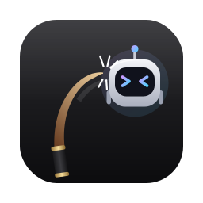

<p align="center">
  
</p>

<h1 align="center">Whip</h1>

<p align="center">
  AI가 느릴 때, 화면을 채찍으로 <b>찰싹!</b><br>
  오래 걸리는 작업 시켜 놓고 기다리는 동안 마음껏 때리는 macOS 앱
</p>

<p align="center">
  <a href="../../releases/latest"><b>⬇️ 최신 버전 다운로드</b></a> ·
  <a href="#english">English</a>
</p>

---

## 이런 앱이에요

- **클릭하면 채찍** — 커서 옆 손잡이에서 긴 가죽 채찍이 날아가 찰싹! 소리와 함께 때려요
- **꾹 눌렀다 놓으면 필살기** — 게이지를 모았다가 놓으면 최대 12연타 + 마무리 한 방
- **효과 5종** — ⚡ 번개 · 🌪 바람 · 🔥 불 · 💧 물 · 🎲 랜덤
- **조준선** — 채찍 끝이 어디 떨어질지 미리 보여요
- **말풍선** — 때릴 때마다 "언제 끝나?", "빨리 해" 같은 말이 떠요 (문장은 직접 바꿀 수 있어요)
- **방해 안 함** — `⌥ Option + ESC`로 언제든 켜고 끌 수 있고, 꺼져 있을 땐 마우스를 평소처럼 써요

## 설치

1. [Releases](../../releases/latest)에서 `Whip-x.x.x.dmg`를 받아 열어요
2. 창 안의 **Whip**을 **Applications** 폴더로 끌어다 놓아요
3. 응용 프로그램 폴더에서 Whip을 실행해요

### 처음 열 때 "확인할 수 없음" 경고가 뜨면

Whip은 Apple 유료 개발자 인증서 없이 배포하는 무료 앱이라, 처음 한 번은 직접 허용해 줘야 해요.

1. Whip을 열면 경고가 뜨는데, **완료**를 눌러 닫아요
2. **시스템 설정 → 개인정보 보호 및 보안**으로 가요
3. 아래쪽에 "Whip이(가) 차단되었습니다"라는 문구 옆의 **그래도 열기**를 눌러요

또는 터미널에서 한 줄로 해결할 수도 있어요.

```bash
xattr -dr com.apple.quarantine /Applications/Whip.app
```

한 번 허용하면 그다음부터는 그냥 열려요.

## 사용법

| 동작 | 하는 일 |
|---|---|
| 클릭 | 채찍 한 방 |
| 꾹 눌렀다 놓기 | 필살기 (오래 누를수록 연타 수 증가, MAX 12연타) |
| `⌥ Option + ESC` | 어디서든 채찍 모드 켜기 / 끄기 |
| `ESC` | 채찍 모드 끄기 |
| Dock 아이콘 클릭 | 채찍 모드 켜기 |
| Dock 아이콘 우클릭 | 효과 선택, 말풍선 문장 바꾸기 |

- 채찍 모드가 켜져 있는 동안에는 클릭이 다른 앱으로 전달되지 않아요. 실수로 뭘 누를 걱정 없이 때려도 돼요.
- 상단 메뉴 **Whip → 로그인할 때 자동으로 켜기**를 체크하면 맥을 켤 때 조용히 대기하고, `⌥ESC`로 바로 쓸 수 있어요.

## 효과

| 효과 | 한 방 | 필살기 마무리 |
|---|---|---|
| ⚡ 번개 | 스파크와 불똥 | 하늘에서 낙뢰 + 화면 번쩍 |
| 🌪 바람 | 나뭇잎과 흙먼지 | 회오리 + 화면을 가로지르는 돌풍 |
| 🔥 불 | 불꽃, 연기, 불탄 자국 | 불길이 번지고 불기둥이 솟음 |
| 💧 물 | 물보라, 물결, 젖은 자국 | 큰 물보라 + 쏟아지는 비 |
| 🎲 랜덤 | 매번 다른 효과 | 필살기마다 다른 효과 |

모든 그림과 소리는 코드로 직접 만들어서, 외부 리소스 없이 앱 하나로 동작해요.

## 소스에서 직접 빌드

Xcode 또는 Command Line Tools(`xcode-select --install`)가 필요해요.

```bash
git clone <이 저장소 주소>
cd whip
./install.sh          # 빌드해서 응용 프로그램 폴더에 설치
```

- `./scripts/build-app.sh` — `build/Whip.app`만 만들기
- `./scripts/make-dmg.sh` — 배포용 `build/Whip-x.x.x.dmg`, `.zip` 만들기
- `python3 scripts/make-icon.py` — `Resources/icon.svg`를 고친 뒤 앱 아이콘 다시 만들기 (`pip install cairosvg` 필요)

### 새 버전 배포하기

`v`로 시작하는 태그를 올리면 GitHub Actions가 자동으로 앱을 빌드해서 Releases에 DMG와 ZIP을 올려요.

```bash
git tag v1.0.0
git push origin v1.0.0
```

## 요구 사항

- macOS 13 Ventura 이상
- Apple Silicon / Intel 모두 지원

## 라이선스

[MIT](LICENSE)

---

<a name="english"></a>

## English

**Whip** is a silly little macOS app for when your AI is taking forever. Click anywhere and a leather whip cracks across your screen. *Thwack!*

**Features**

- **Click to whip** — a long lash flies out from the cursor and cracks with a sound
- **Hold & release for a special move** — charge up to a 12-hit combo with a finisher
- **5 effects** — ⚡ Lightning · 🌪 Wind · 🔥 Fire · 💧 Water · 🎲 Random
- **Crosshair** — see where the tip will land before you strike
- **Speech bubbles** — "Are you done yet?" style lines pop up on each hit (customizable)
- **Stays out of your way** — toggle anytime with `⌥ Option + Esc`; when it's off, your mouse works normally

**Install**

1. Download `Whip-x.x.x.dmg` from [Releases](../../releases/latest) and drag **Whip** into **Applications**
2. Because Whip isn't signed with a paid Apple Developer certificate, macOS will block it the first time. Close the warning, then go to **System Settings → Privacy & Security** and click **Open Anyway**. Or run:
   ```bash
   xattr -dr com.apple.quarantine /Applications/Whip.app
   ```

**Controls**

| Action | What it does |
|---|---|
| Click | Whip |
| Press & hold, then release | Special move (longer hold = more hits) |
| `⌥ Option + Esc` | Toggle whip mode from anywhere |
| `Esc` | Turn whip mode off |
| Click the Dock icon | Turn whip mode on |
| Right-click the Dock icon | Pick an effect, edit speech bubbles |

While whip mode is on, clicks don't reach other apps, so you can't accidentally click anything.

**Build from source**

```bash
git clone <this repo>
cd whip
./install.sh
```

Requires macOS 13+ and Xcode or Command Line Tools. Push a `v*` tag to have GitHub Actions build and publish a release automatically.

**License** — [MIT](LICENSE)
